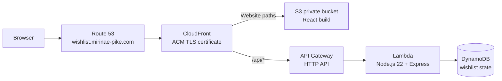

# Miri-wishlist

A beautiful gift wishlist website for Mirinae, allowing family and friends to view and mark items as purchased.

## Features

- ✨ Add gift items with product links (Amazon, Target, etc.) or experiences
- 🔢 Quantity tracking - items count down as people buy them
- ✅ Purchase marking - click "I'll Buy This!" to mark items
- 🎨 Beautiful, responsive design that works on all devices
- 📱 Mobile-friendly interface
- 🔗 Public sharing capability

## Tech Stack

- **Frontend**: React 18, built as static files and hosted in a private S3 bucket
- **CDN and TLS**: CloudFront with an ACM certificate in `us-east-1`
- **API**: API Gateway HTTP API and Node.js 22 Lambda running Express
- **Database**: DynamoDB, on-demand billing with point-in-time recovery
- **Infrastructure**: AWS SAM and CloudFormation

## Local Development

### Prerequisites

- Node.js 22+ and npm (the Lambda runtime is Node.js 22)

### Installation

Install the root and client dependencies:
```bash
npm run install-all
```

Run the API and frontend in separate terminals:
```bash
npm run server
npm run client
```

The API listens on `http://localhost:3001`; the React development server defaults to `http://localhost:3000`. Local API data uses the ignored `wishlist.json` file. Set `ADMIN_PASSWORD` in the local shell to enable admin login.

### Production Build

```bash
# Build the React app
npm run build

# Start the Express server and serve the build locally
NODE_ENV=production npm start
```

## API Endpoints

- `GET /api/items` - Get all wishlist items
- `POST /api/auth/verify` - Verify the admin password and issue an admin session cookie
- `POST /api/auth/logout` - Clear the admin session cookie
- `POST /api/items` - Add a new item (admin)
- `POST /api/items/:id/purchase` - Mark one unit as purchased (decreases quantity)
- `PATCH /api/items/:id/quantity` - Update item quantity (admin)
- `PUT /api/items/reorder` - Reorder items (admin)
- `PUT /api/items/:id` - Edit an item (admin)
- `POST /api/items/:id/restore` - Restore a purchased item (admin)
- `POST /api/items/:id/fetch-image` - Fetch an image from the product link (admin)
- `PATCH /api/items/:id/image` - Set or clear an image URL (admin)
- `DELETE /api/items/:id` - Delete an item (admin)

## Current AWS Architecture

The production site is serverless. The React app and API share one HTTPS hostname; CloudFront routes requests by path.



### Production resources

| Resource | Current value |
| --- | --- |
| Public URL | [https://wishlist.mirinae-pike.com](https://wishlist.mirinae-pike.com) |
| Route 53 hosted zone | `mirinae-pike.com` (`Z0909204AUKQJUG88FMB`) |
| CloudFormation/SAM stack | `mirinae-wishlist` in `us-east-2` |
| CloudFront distribution | `E2CX58WN592XK4` (`d3d48sbavw1s7h.cloudfront.net`) |
| ACM certificate | `us-east-1`, for `wishlist.mirinae-pike.com` |
| API Gateway endpoint | `https://bedtbv1f09.execute-api.us-east-2.amazonaws.com` |
| S3 website bucket | `mirinae-wishlist-websitebucket-wid2nnphjszx` (private; CloudFront access only) |
| DynamoDB table | `mirinae-wishlist-WishlistTable-1QY7KOPEXRR6K` |

The Route 53 A record is an alias to CloudFront. ACM DNS validation is retained in Route 53 for certificate renewal. CloudFront enforces HTTPS and TLS 1.2 or later; plain HTTP redirects to HTTPS.

### API and data

- `GET /api/items` and `POST /api/items/:id/purchase` are public so visitors can browse and mark gifts purchased.
- Admin operations require the signed, HttpOnly `admin_session` cookie issued by `POST /api/auth/verify`. The session expires after 24 hours. Admin writes are checked by the API, not only by the frontend.
- Lambda reads `ADMIN_PASSWORD` from its environment, supplied by the `AdminPassword` SAM parameter. It is not stored in DynamoDB. Use a password of at least 16 characters when deploying or changing it.
- The DynamoDB record is keyed by `pk = wishlist` and currently holds the whole state document, including purchaser names/messages. The table uses on-demand billing and point-in-time recovery. The application checks the DynamoDB item-size ceiling; this one-record design is appropriate for the current small list, not unbounded growth.
- `scripts/import-wishlist.js` imports an API export. It refuses to replace an existing record unless explicitly run with `--replace`.

### Deploy and update

Infrastructure is defined in `template.yaml`. The CloudFront alias and certificate are declared there so future deployments retain custom HTTPS routing.

```bash
sam validate --lint
sam build
sam deploy
```

For a first deployment or to change parameters, use `sam deploy --guided`. The `AdminPassword` parameter is masked by CloudFormation; do not put the password in a command or commit it in configuration.

To publish a frontend update:

```bash
npm run build
aws s3 sync client/build s3://mirinae-wishlist-websitebucket-wid2nnphjszx --delete
aws cloudfront create-invalidation --distribution-id E2CX58WN592XK4 --paths '/*'
```

To import an API export into the production table, review the JSON first and run:

```bash
TABLE_NAME=mirinae-wishlist-WishlistTable-1QY7KOPEXRR6K AWS_REGION=us-east-2 \
  node scripts/import-wishlist.js /path/to/wishlist-items.json
```

API exports contain purchaser information; store and share them accordingly.

### Retired EC2 host

The former `Mirinae` instance (`i-00ef778834837bc7f`) is stopped. Its root EBS volume (`vol-0d06c6947382ca907`) and completed snapshot (`snap-0c03b3856544407a9`) were retained as a recovery path. Do not terminate the instance or delete the volume/snapshot until the serverless site and data have been independently verified and the recovery copy is no longer needed.

AWS charges can still accrue for the stopped instance's EBS volume and snapshot, as well as for the active CloudFront distribution, DynamoDB point-in-time recovery, storage, and requests.

## Support

For issues or questions, please create an issue in the GitHub repository.

## License

MIT
